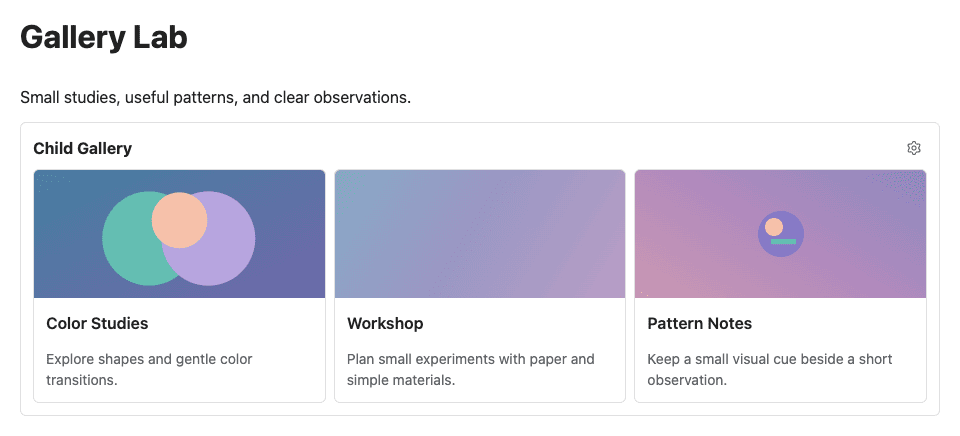
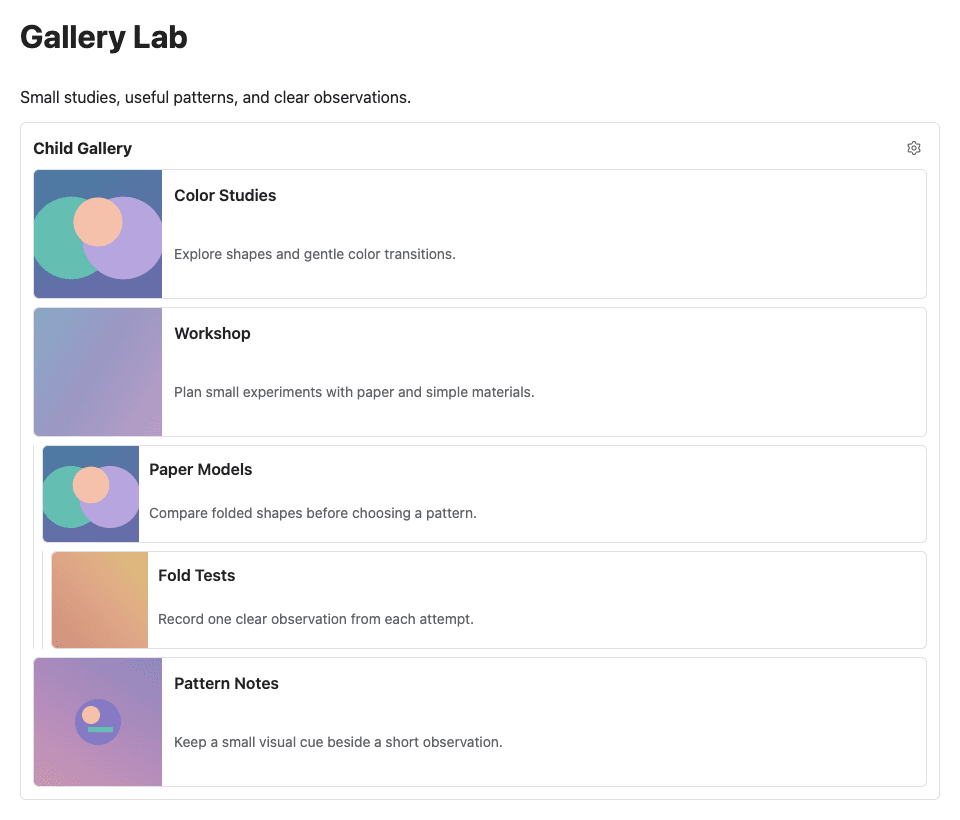
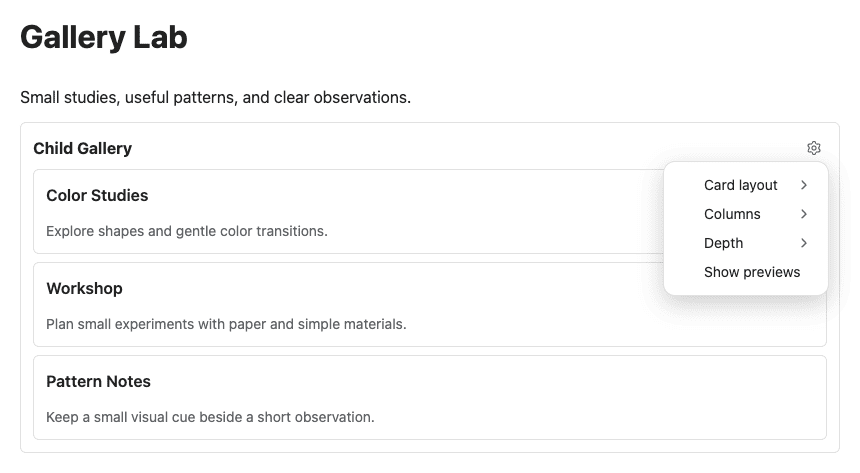

# Unterseiten-Galerie

[English](README.md)

Zeige die Unterseiten eines Dokuments als Galerie anklickbarer Karten mit Titeln, kurzen Beschreibungen und Vorschaubildern. Jede Galerie folgt dem Dokument, in dem sie steht, und behält ihre eigenen Einstellungen.

Benötigt **SiYuan 3.8.3+** und ein normales Notizbuch. Die Oberfläche ist auf Deutsch und Englisch verfügbar.



## Funktionen

* Unterseiten-Galerien bis Tiefe 3 mit SiYuans eigener Reihenfolge und Hierarchie.
* Vertikale oder horizontale Karten mit automatischer Spaltenzahl oder 1–4 Spalten.
* Titel, Beschreibungen und das erste geeignete Inhaltsbild als Vorschau.
* Lokal erzeugte Farbverläufe für Seiten ohne nutzbares Bild.
* Angepasste Darstellung kleiner Rasterbilder und eine optionale reine Textansicht.
* Native Dokumentnavigation per Klick, Enter oder Leertaste; unabhängige Einstellungen in jedem Galerieblock.

## Einfügen und verwenden

1. Öffne das Dokument, dessen Unterseiten du anzeigen möchtest.
2. Tippe `/galerie` und wähle **Unterseiten-Galerie** im Slash-Menü. Alternativ verwende die Aktion **Unterseiten-Galerie** in der Editor-Werkzeugleiste; SiYuans Einstellungen steuern die Verfügbarkeit der Einträge.
3. Wähle eine Karte, um ihr Dokument zu öffnen.
4. Passe die Darstellung über **Galerie-Einstellungen** im Galeriekopf an.

Zuerst erscheinen die Titel, danach Beschreibungen und Vorschaubilder. Eine zusätzliche Galerie verändert die Einstellungen vorhandener Galerien nicht.

## Tiefe und Hierarchie

**Tiefe 1** zeigt direkte Unterseiten. **Tiefe 2** ergänzt deren Kinder, **Tiefe 3** eine weitere Ebene. Das enthaltende Dokument selbst erhält keine Karte.

Nachkommen stehen eingerückt unter ihrer jeweiligen Elternkarte. Die Reihenfolge auf jeder Ebene und das Ausblenden versteckter Dokumente folgen SiYuans Dokumentbaum. Scheitert eine tiefere Abfrage, bleiben ihre Elternkarte und andere Zweige verfügbar.



## Galerie-Einstellungen

| Einstellung             | Auswahl                     | Standard    |
| ----------------------- | --------------------------- | ----------- |
| **Kartendarstellung**   | Vertikal / Horizontal       | Vertikal    |
| **Spalten**             | Automatisch / 1 / 2 / 3 / 4 | Automatisch |
| **Tiefe**               | 1 / 2 / 3                   | 1           |
| **Vorschauen anzeigen** | An / aus                    | An          |

Die Einstellungen werden lokal im Galerieblock gespeichert. Kartendarstellung und Spalten gelten für jede Gruppe von Geschwisterseiten; das Layout passt sich an den verfügbaren Platz an.

Schalte **Vorschauen anzeigen** aus, um reine Textkarten zu erhalten. Titel und Beschreibungen bleiben sichtbar; alle Bilder und generierten Verläufe verschwinden.



## Vorschaubilder und Beschreibungen

Jede Karte verwendet das erste geeignete Bild im Dokumentinhalt und den ersten geeigneten normalen Absatz. Dokument-Icons und Titelbild-Metadaten dienen nicht als Vorschau. Überschriften, Listen, Tabellen, technische Blöcke und erkennbare Bildbeschriftungen werden nicht als Beschreibung verwendet. Beschreibungen erscheinen in höchstens drei Zeilen.

Bilder haben drei Darstellungsformen:

* **COVER:** Ein geeignetes Bild füllt die Vorschaufläche.
* **CONTAINED:** Ein erkennbares kleines Rasterbild bleibt höchstens in natürlicher Größe über einem generierten Verlauf zentriert, wenn das Füllen der Fläche mehr als 1,5-fache Vergrößerung erfordern würde. Größenänderungen können diese Einordnung ändern.
* **FALLBACK:** Fehlt ein nutzbares Bild oder scheitert das Laden, füllt ein lokal erzeugter Verlauf die Vorschaufläche. Seine Farben bleiben für das Dokument stabil und werden mit der Themenoberfläche abgestimmt.

Echte Bilder haben Vorrang. SVGs und nicht erkennbare Bildformate behalten die normale Cover-Darstellung. Nicht unterstützte oder unsichere Bildquellen werden ignoriert. Fehler bei der Vorschau lassen die Titelkarte verfügbar.

## Installation

Die Unterseiten-Galerie ist noch nicht im SiYuan-Marktplatz gelistet. Verwende **package.zip** aus einer [Projektveröffentlichung](https://github.com/blacknet76/siyuan-child-gallery/releases), sobald verfügbar, oder baue das Paket lokal wie unten beschrieben.

1. Entpacke den ZIP-Inhalt direkt nach `data/plugins/siyuan-child-gallery/` im SiYuan-Arbeitsbereich, ohne einen zusätzlichen umschließenden Ordner.
2. Aktiviere **Unterseiten-Galerie** unter **Marktplatz → Heruntergeladen**.
3. Lade SiYuan nach dem Austausch eines installierten Pakets neu.

Der Build installiert das Plugin nicht automatisch.

## Kompatibilität und Grenzen

* Benötigt **SiYuan 3.8.3+**. Normale Notizbücher werden unterstützt, verschlüsselte Notizbücher nicht.
* Desktop und die Browser-Mobiloberfläche wurden live getestet. Für native Android-/iOS-Apps, ältere Laufzeitversionen, Export und schreibgeschützte Modi liegt keine bestätigte Live-Abdeckung vor. Eine vollständige Plattform- oder Themenkompatibilität wird nicht zugesichert.
* Struktur- und Inhaltsänderungen erscheinen, wenn SiYuan die Galerie erneut rendert. Öffne das Dokument bei Bedarf erneut; es gibt kein Polling und keinen eigenen Aktualisierungsknopf.
* Die Tiefe begrenzt Ebenen, nicht die Anzahl der Dokumente oder deren Inhaltsgröße. Sehr große Hierarchien können Zeit benötigen; es gibt keine Seiteneinteilung und kein stilles Abschneiden.
* Galerieblöcke sind in SiYuans Veröffentlichungsmodus deaktiviert. Ist das Plugin nicht verfügbar, erhält SiYuan die gespeicherte Blockkonfiguration als Text.

## Datenschutz und Netzwerk

Die Unterseiten-Galerie liest Dokumentinformationen über SiYuans lokale APIs. Ersatzcover werden lokal erzeugt; es wird kein externer Dienst für Ersatzbilder verwendet.

Vorschaubilder können auf HTTP(S)-Quellen verweisen, die bereits im Notizinhalt stehen. Ihre Anzeige kann externe Anfragen durch SiYuan oder den Browser auslösen. Solche Bilder benötigen daher den üblichen Netzwerkzugriff.

## Entwicklung

Verwende Node.js 24+ und pnpm 11 (Repository-Pin: `pnpm@11.4.0`).

```sh
pnpm install --frozen-lockfile
pnpm run typecheck
pnpm run lint
pnpm test
pnpm run format:check
pnpm run dev --no-watch
pnpm run build
pnpm run validate:package
pnpm run validate:package:build
```

`pnpm run dev` überwacht Änderungen und schreibt Entwicklungs-Laufzeitdateien ins Repository-Hauptverzeichnis. `pnpm run build` erzeugt `dist/` und das installierbare `package.zip`, einschließlich der vier READMEs und drei Dokumentations-Screenshots. Generierte Build-Ausgaben werden von Git ignoriert.

`pnpm run validate:package` prüft die vorhandene Distribution. `pnpm run validate:package:build` baut und prüft frische Produktionsausgaben in einem temporären Verzeichnis. SiYuan stellt die Plugin-API bereit; der Build folgt dem [offiziellen Plugin-Sample](https://github.com/siyuan-note/plugin-sample).

## Lizenz

Die Unterseiten-Galerie steht unter der [MIT-Lizenz](LICENSE). Die [Drittanbieterhinweise](THIRD_PARTY_NOTICES.md) enthalten die erhaltenen Zuschreibungen und Hinweise zu generierten Build-Hilfsfunktionen. Quellcode und Dokumentation findest du im [Projekt-Repository](https://github.com/blacknet76/siyuan-child-gallery).
